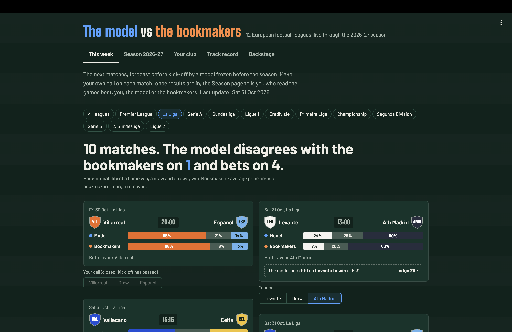

# Model vs Market

**Can a model built on past football results beat the betting market?** Elo, Dixon-Coles and their
combination, tested against Pinnacle's closing prices on 35,647 matches from 12 European leagues,
under a protocol frozen before any modelling. Then a live forward test on the 2026-27 season,
with every forecast committed to git before kick-off.

Read the **[research note](docs/research_note.md)** (5 pages), the frozen
**[protocol](docs/protocol.md)**, or run the dashboard with `make app`.

## Key results (test seasons 2017-18 to 2024-25)

- The Elo + Dixon-Coles combination **closes 79% of the information gap** between naive base
  rates and the closing market (log-loss 1.0099 vs 1.0756 and 0.9925), and significantly beats
  both of its members, which are tied with each other.
- It has **no exploitable edge**: value betting at Pinnacle's pre-match price loses
  **-4.0% of closing line value** per bet (95% CI [-4.2%, -3.8%]), half a point better than a
  bettor with no information. A positive control that cheats with closing prices gains +10.8%,
  so the backtest can see an edge when there is one.
- **The bigger the model's disagreement with the market, the worse the bet**, and the optimal
  weight of the model in a mixture with the pre-match price is zero.
- 14 expectations were written down before the test runs: 10 confirmed, 1 weakly, 3 failed.
  All are reported.




## What is in the repo

| | |
|---|---|
| Data pipeline | football-data.co.uk, 94,619 matches 2005-2026, 3.5M odds rows, immutable raw files with SHA-256 manifest, quarantine instead of correction |
| Protocol | season splits, walk-forward by week with results physically hidden from `predict()`, Shin margin removal, log-loss with week-clustered bootstrap, test seasons locked and logged |
| Models | Elo with ordered-logit calibration; Dixon-Coles with time decay, low-score correction and L2 prior (analytic gradient, warm-started L-BFGS); 50/50 linear pool |
| Backtest | value betting, fractional Kelly, closing line value, positive and negative controls, encompassing (blend) test |
| Live | `make live`: weekly fixtures and prices, frozen models, timestamped forecast log |
| Dashboard | Streamlit: this week, live season, your club, 2012-2025 track record, technical backstage |
| Tests | 105 tests, including simulated leagues with known truth and the backtest controls |

## Quickstart

```bash
make install           # uv sync (Python 3.11+)
make data              # download football-data.co.uk CSVs and build canonical tables
make test
make market-baseline   # how good is the closing market? (the bar to clear)
make tune-elo          # grid search on the tuning seasons only
make eval-elo          # Elo vs market vs naive base rates, tuning seasons
make tune-dc           # Dixon-Coles grid search (time decay, L2 prior)
make eval-dc           # Dixon-Coles vs market, base rates and Elo
make eval-ens          # 50/50 Elo + Dixon-Coles combination
make predict           # cache walk-forward predictions of all models
make backtest          # value betting, Kelly, CLV and blend test (tuning seasons)
make test-backtest     # same on the test seasons, run once
make figures           # figures of the research note
make live              # every week: current season, upcoming fixtures, timestamped forecasts
make app               # dashboard
```

## Architecture

```
src/mvm/
├── core/            sport-agnostic: schema, margin removal, metrics, walk-forward, backtest, CLV
├── app/             Streamlit dashboard
└── sports/
    ├── foot/        football-data.co.uk, Elo, Dixon-Coles, live season
    └── nba/         (next) same pipeline, reusing core/
```

`core/` never imports from `sports/`. A sport plugs in by producing three canonical tables:
`events` (one row per match), `odds` (one row per match, bookmaker, market, timing and outcome)
and `teams` (raw name to stable team id).

## Roadmap

- [x] (a) Data pipeline and storage schema ([data card](data/README.md))
- [x] (b) Frozen evaluation protocol ([`docs/protocol.md`](docs/protocol.md))
- [x] (c) Elo baseline ([`docs/results_elo.md`](docs/results_elo.md)): closes 76% of the gap
- [x] (d) Dixon-Coles and combination ([`docs/results_dc.md`](docs/results_dc.md)): tie, and a combination that beats both
- [x] (e) Value-betting backtest ([`docs/results_betting.md`](docs/results_betting.md)): no exploitable edge, validated by controls
- [x] (f) Dashboard, live through 2026-27 ([`docs/live_2026_27.md`](docs/live_2026_27.md))
- [x] (g) [Research note](docs/research_note.md)
- [ ] v2: expected-goals features, hypothesis registered before testing on the live season
- [ ] NBA module

Data: [football-data.co.uk](https://www.football-data.co.uk). This project is a forecasting
study, not betting advice.
