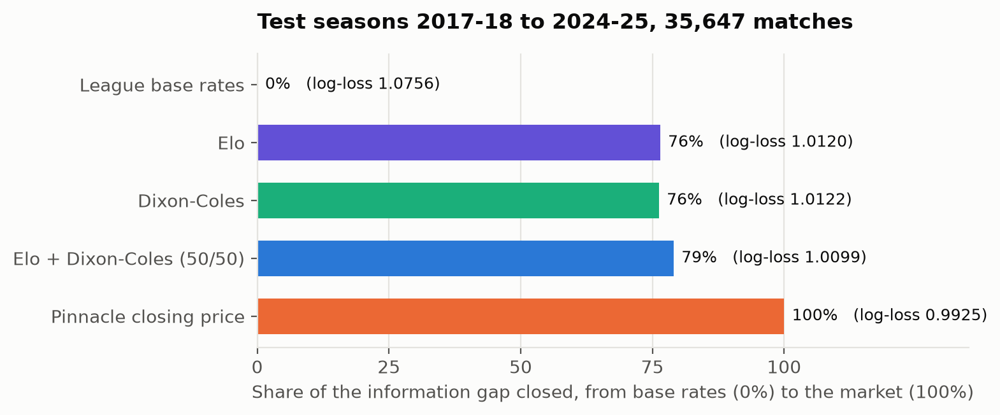
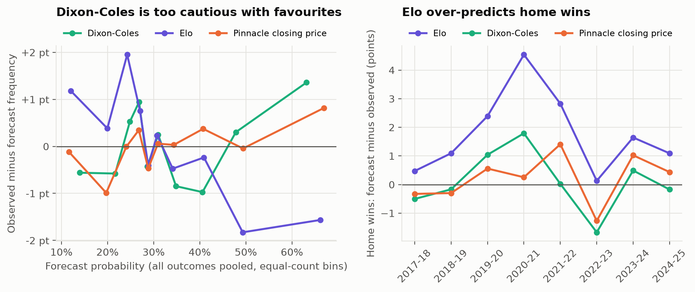
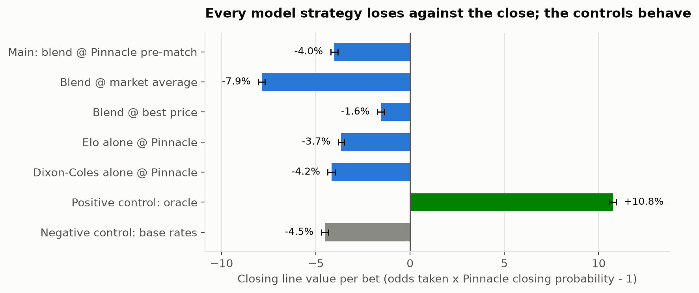
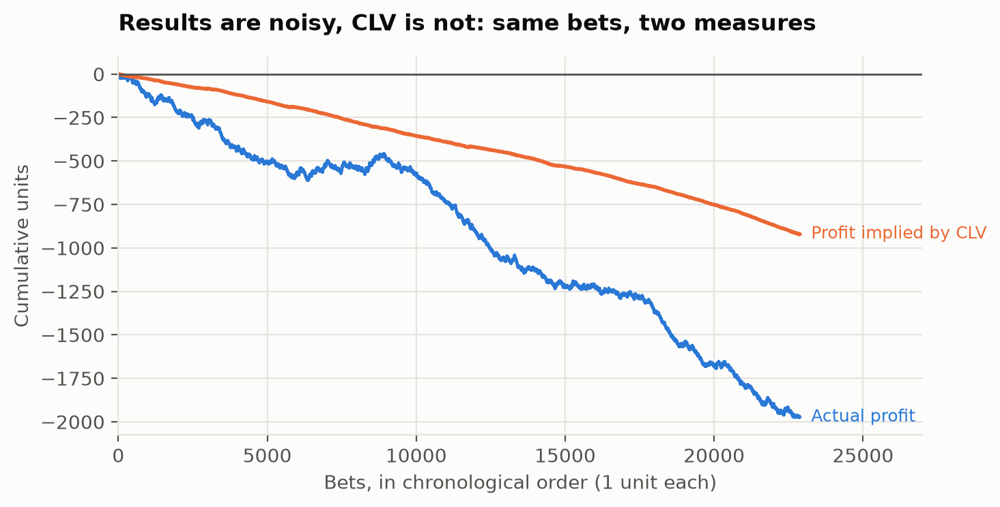
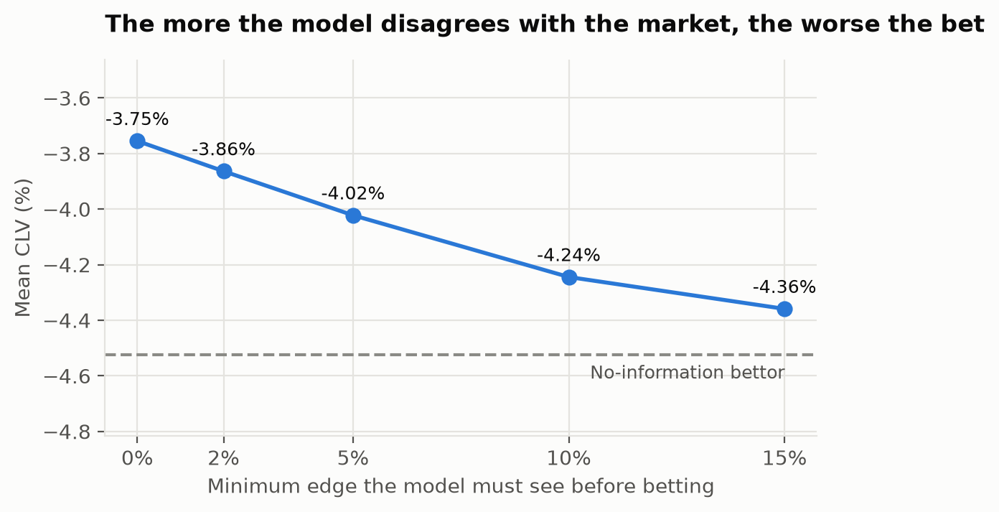

# Can a results-only model beat the football betting market?

**A pre-registered study on 12 European leagues, 2012 to 2025, with a live forward test in 2026-27**

Najib Nasr, October 2026. Code, data pipeline and every intermediate result:
[github.com/najibnasr/model-vs-market](https://github.com/najibnasr/model-vs-market).

---

## Summary

I built two classic football models (Elo and Dixon-Coles) and their 50/50 combination, and compared
them with the closing prices of Pinnacle, the sharpest widely recorded bookmaker, on 35,647
matches from 12 European leagues (test seasons 2017-18 to 2024-25). Everything was evaluated
walk-forward, week by week, under a protocol frozen before any modelling, with expectations
written down before each test was run.

- **The combination closes 79% of the information gap** between naive league base rates and the
  closing market (log-loss 1.0099 against 1.0756 for base rates and 0.9925 for the market). It
  significantly beats both of its members, which are statistically tied with each other.
- **It has no exploitable edge.** A value-betting strategy at Pinnacle's pre-match price loses
  4.0% of closing line value per bet (95% CI [-4.2%, -3.8%]), barely better than a bettor with no
  information at all (-4.5%). A positive control that cheats with closing prices gains +10.8%,
  which shows the backtest can detect a real edge when there is one.
- **The model's largest disagreements with the market are its worst bets**: closing line value
  gets monotonically worse as the betting threshold rises. Mixing the model into the pre-match
  price never improves it (optimal weight: zero).
- Of 14 expectations registered before the test runs, 10 were confirmed, 1 only weakly, and 3
  failed. All are reported.

The conclusion is a measurement, not a disappointment: past scores carry most of the
information in a football price, and all of what they carry is already in the price. A live
forward test on the 2026-27 season, with every forecast logged before kick-off, is running.

---

## 1. Question and benchmark

A bookmaker's price is a forecast. After removing the margin, closing odds are among the best
public probability estimates available for a sports event: they aggregate team news, line-ups and
the money of professional bettors up to kick-off. Beating them is the standard of proof in sports
forecasting, in the same way that beating a liquid market price is in finance.

The question is narrow on purpose: **how much of the market's information can be recovered from
past results alone, and is any of it not yet priced?** The models see only dates, teams and
scores. They never see odds, line-ups or player data.

## 2. Data

[football-data.co.uk](https://www.football-data.co.uk): one CSV per league and season, 2005-06
to 2025-26, for the top two tiers of England, Spain, Italy, Germany and France, plus the top
tiers of the Netherlands and Portugal. After parsing: 94,619 matches, 3.5 million odds rows
(one row per match, bookmaker, timing and outcome) and 423 teams.

- Raw files are immutable and fingerprinted (SHA-256 manifest). Team names are mapped to stable,
  country-scoped identifiers, so a promoted club keeps its history across tiers.
- Odds are never corrected. A price triplet is quarantined when the implied overround falls
  outside a plausible range (0.04% of rows).
- Pinnacle prices exist from 2012-13, which fixes the start of the evaluation. Football-data
  stopped publishing them during 2025-26, which matters for the live test (section 6).

## 3. Protocol

The protocol was written and frozen before any model was fitted
([`docs/protocol.md`](protocol.md)).

**Splits by whole seasons.** Matches are not exchangeable, so there is no random
cross-validation. 2005-06 to 2011-12 is burn-in (models learn, nothing is scored); 2012-13 to
2016-17 is for tuning; **2017-18 to 2024-25 is the test, run once per final model and logged**;
2025-26 is held out for a future version; 2026-27 is the live forward test.

**Walk-forward by calendar week.** Before week *w*, a model receives every result played before
*w*, then predicts all matches of *w*. Result columns are physically removed from the data passed
to the prediction function, so a model that tries to read them crashes (tested). Whole weeks are
deliberately conservative: kick-off times are missing on older seasons, so a Sunday match must
not learn from the same weekend's Saturday results.

**Market reference.** Pinnacle closing odds, margin removed with Shin's method, which models the
favourite-longshot bias instead of spreading the margin proportionally. Pre-registered checks
confirmed the choice: Shin beats proportional normalisation (-0.00017 log-loss, CI excluding
zero), and the close beats Pinnacle's own pre-match price by 0.0027. That last number sets the
scale: **the whole information value of the last days before kick-off is about 0.003 of
log-loss.** A model claiming to beat the close by more than that should be suspected of leakage.

**Metric and decision rule.** Log-loss is the primary metric. It is strictly proper, and it is
the right currency for a bettor: the expected log-growth of a Kelly bettor against the market
equals the log-loss difference between market and model. For two forecasts on the same matches,
the mean per-match difference gets a 95% interval from a bootstrap clustered by week (2,000
resamples). "A beats B" only if the whole interval is below zero. League or season breakdowns
found after looking are labelled exploratory.

## 4. Models

**Elo.** One rating per team, updated after each match with K = 15, a home advantage of 70
points, a goal-margin multiplier and 10% regression to the mean between seasons. Rating
differences are mapped to home/draw/away probabilities by an ordered logit fitted per league on
past seasons only.

**Dixon-Coles.** Attack and defence strengths per team in a bivariate Poisson model of goals,
with the low-score correction of Dixon and Coles (1997), exponential time decay (half-life about
350 days, chosen on the tuning seasons; the paper's 3.5 months was clearly worse here) and an L2
prior that shrinks strengths towards the league mean. Fitted per country (both tiers jointly) by
L-BFGS with an analytic gradient, warm-started every week.

**Combination.** A 50/50 linear pool of the two, with weights fixed a priori rather than tuned.

| Test seasons 2017-18 to 2024-25 (35,647 matches) | Log-loss | Gap closed |
|---|---|---|
| League base rates | 1.0756 | 0% |
| Elo | 1.0121 | 76% |
| Dixon-Coles | 1.0122 | 76% |
| **Elo + Dixon-Coles (50/50)** | **1.0099** | **79%** |
| Pinnacle closing price | 0.9925 | 100% |



Paired differences (95% CI): Dixon-Coles vs Elo +0.0001 [-0.0013, +0.0014]; combination vs Elo
-0.0022 [-0.0029, -0.0015]; combination vs Dixon-Coles -0.0023 [-0.0030, -0.0016]; combination
vs market +0.0175 [+0.0157, +0.0194]. No model beats the market in any of the 12 leagues.

**More complex is not better, but different is.** Dixon-Coles is not more accurate than Elo.
They fail differently, which is why their average beats both:

- **Elo over-predicts home wins** (45.2% predicted against 43.4% observed on the test seasons).
  Home advantage has been falling for years and its calibration, learned on up to 15 past
  seasons, lags behind. Dixon-Coles, with time-decayed weights, is within 0.1 point. Its relative
  advantage is largest in the seasons played behind closed doors (exploratory).
- **Dixon-Coles is too cautious with favourites**: outcomes it prices above 75% happen more often
  than predicted, consistent with the L2 prior pulling strengths towards the mean.



The combination is the best or within 0.0003 of the best model in each of the 8 test seasons,
so its gain does not come from one lucky season.

## 5. Betting backtest

**Strategy (frozen before the first run).** For each match, the outcome with the largest model
edge, *p* x *odds* - 1, is bet if that edge exceeds 5% and the odds are at most 10. Bets are
placed at Pinnacle's **pre-match** price, the only price available when the model has its
information. Stakes follow a quarter of the Kelly criterion, capped at 2% of the bankroll per
bet and 25% per week. Fractional Kelly matters here: full Kelly with overestimated probabilities
leads to ruin.

**Closing line value (CLV)** is the primary betting statistic: odds taken x Pinnacle closing
probability - 1. Profit depends on a few thousand noisy outcomes; CLV compares each price with the
best estimate of its fair value, so its confidence interval is about ten times narrower than the
ROI's. Two controls validate the backtest itself: a **positive control** that cheats by betting
with closing probabilities (it must win), and a **negative control** that bets with league base
rates (it must lose roughly the margin).

| Test seasons, 35,525 matches | Bets | ROI | CLV | CLV 95% CI |
|---|---|---|---|---|
| **Main: combination @ Pinnacle pre-match** | 22,875 | -8.6% | **-4.02%** | [-4.22%, -3.84%] |
| Combination @ market average | 17,602 | -11.1% | -7.87% | [-8.05%, -7.69%] |
| Combination @ best price across books | 26,770 | -5.0% | -1.56% | [-1.74%, -1.38%] |
| Positive control: oracle | 10,966 | +9.1% | **+10.76%** | [+10.57%, +10.94%] |
| Negative control: base rates | 31,454 | -7.5% | **-4.52%** | [-4.72%, -4.33%] |



**The backtest works, the model does not.** The oracle multiplies its bankroll and the
no-information bettor loses the margin, as they must. The model sits about half a point of CLV
above knowing nothing, in both the tuning and the test periods. With quarter Kelly and around 60
bets a week, a small negative edge compounds into a 99.9% loss.



**Profit is noise, CLV is signal.** Several leagues show a positive ROI while their CLV is
negative (on the tuning seasons, Bundesliga +5.2% and La Liga +3.7%): that is luck, and CLV says
so. Every league has a negative CLV on the test seasons.



**When the model disagrees most, the market is right.** Raising the edge threshold from 0% to
15% makes CLV worse at every step (-3.75% to -4.36%), and long odds are the worst bets (-5.8%
between odds 5 and 10). If the model's edges carried information, larger edges would be better
bets. They are mostly the model's own errors.

**Encompassing test.** Fitting the best mixture *w* x model + (1 - *w*) x market on the tuning
seasons gives *w* = 0 against both the closing and the pre-match Pinnacle price: the price
already contains everything the model knows.

## 6. Live forward test, 2026-27

The 2026-27 season was loaded only after the models and the strategy were frozen. Every week,
`make live` downloads the latest results and the upcoming fixtures with their prices, replays the
frozen models and **appends their forecasts to a log committed to git before kick-off**, which
makes each forecast's timing publicly verifiable. The dashboard shows the live season next to the
historical record.

Because Pinnacle prices are no longer published, the live reference is the market average, as
planned by the protocol's fallback rule. The average is slightly less sharp than Pinnacle (a
pre-registered check showed the difference is significant), so live results are optimistic for
the model. Expectations for the end of the season were written before the first download
([`docs/live_2026_27.md`](live_2026_27.md)): the market average beats the model by +0.010 to
+0.025 of log-loss, the main strategy's CLV is negative, the controls behave, and the bankroll
ends below its start.

## 7. Pre-registered expectations: scorecard

| Step | Registered | Confirmed | Weak | Failed |
|---|---|---|---|---|
| Market reference (fallback check) | 1 | 0 | 0 | 1 |
| Elo, test seasons | 3 | 2 | 1 | 0 |
| Dixon-Coles and combination, test seasons | 5 | 5 | 0 | 0 |
| Betting backtest, test seasons | 5 | 3 | 0 | 2 |
| **Total** | **14** | **10** | **1** | **3** |

The failures are informative. The market average failed to match Pinnacle, so it is used only
as a labelled fallback. CLV moved more across thresholds than expected, but in the direction that
strengthens the conclusion. Best-price CLV was -1.6% rather than near zero, possibly because the
source of the "best price" changed in 2019-20 (untested hypothesis). One exploratory finding from
the tuning seasons, a residual favourite-longshot bias in Pinnacle closing prices, did not
replicate on the test seasons and was dropped.

## 8. Limitations and next steps

- **Information set.** The models ignore exactly what moves prices in the last days: injuries,
  suspensions, line-ups and rotation. The missing 21% of the gap is largely there, and so is any
  real edge, which would also depend on speed.
- **Expected goals.** Shot-based xG measures team quality with less noise than goals. A v2 with xG
  features is planned, with its hypothesis written first (a mixture weight above zero against the
  pre-match price) and evaluated on the 2026-27 live season, the only fully unseen data left. The
  2025-26 holdout was partly viewed through the dashboard and will only count as secondary
  evidence.
- **Execution.** The backtest assumes every bet is accepted at the recorded price. Real books
  limit winning accounts and the recorded pre-match price is a snapshot, so a positive result
  would have needed further scrutiny. A negative one does not.
- **Other sports.** The core (margin removal, metrics, walk-forward, backtest) is sport-agnostic;
  an NBA module is next.

## Reproducibility

```bash
make install && make data      # download and build the canonical tables
make test                      # unit tests, simulated leagues with known truth, controls
make tune-elo && make tune-dc  # tuning seasons only
make predict && make backtest  # walk-forward forecasts, betting backtest (tuning seasons)
make figures                   # the figures of this note
make live && make app          # live season and dashboard
```

The test seasons are locked behind an explicit flag and every run is logged in
`reports/test_log.csv`.

## References

- Dixon, M. J. and Coles, S. G. (1997). Modelling association football scores and inefficiencies
  in the football betting market. *Journal of the Royal Statistical Society, Series C*, 46(2).
- Elo, A. E. (1978). *The Rating of Chessplayers, Past and Present*. Arco.
- Kelly, J. L. (1956). A new interpretation of information rate. *Bell System Technical Journal*,
  35(4).
- Shin, H. S. (1993). Measuring the incidence of insider trading in a market for state-contingent
  claims. *The Economic Journal*, 103(420).
- Štrumbelj, E. (2014). On determining probability forecasts from betting odds. *International
  Journal of Forecasting*, 30(4).
